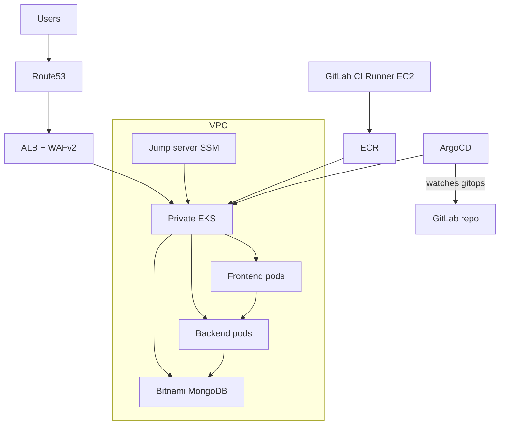
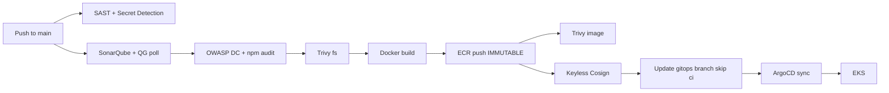

# Architecture overview

Rationale catalog: [`16-design-decisions.md`](./16-design-decisions.md).

## High-level AWS layout

## CI/CD flow

## Why GitLab CI over Jenkins (for this project)

| Concern | GitLab CI (this repo) | Practice |
|---|---|---|
| Credentials | OIDC JWT → STS | C3 |
| Pipeline as code | `.gitlab-ci.yml` + includes | — |
| Security scanning | SAST / secrets / Trivy / OWASP | C4 / C9 |
| Image tag | `$CI_PIPELINE_IID` (immutable ECR) | C5 |
| Runner | Tagged `devsecops` Docker executor | G2 |
| Deploy | ArgoCD watches `gitops` | C1 / C6 |

## Why these AWS shapes

| Choice | Why | Practice |
|---|---|---|
| Private EKS + jump (SSM) | No public API; no SSH key sprawl | C10 |
| OIDC app vs infra roles | Least privilege for CI jobs | C2 / C3 |
| ALB + WAFv2 | Edge filtering before pods | C10 |
| ECR immutable + Cosign + Kyverno | Provenance + admission control | C5 / C10 |
| `main` vs `gitops` | Code review ≠ deploy commits | C1 / C6 |

## Component map

| Layer | Tool | Role |
|---|---|---|
| IaC | Terraform | bootstrap / runner / OIDC / dns (`devops.example.com`) / EKS |
| CI | GitLab CI | build, scan, push, sign |
| Registry | Amazon ECR | immutable images |
| CD | ArgoCD | GitOps from `gitops` branch |
| Ingress | AWS LB Controller + ALB | HTTPS + WAF |
| Policy | Kyverno | admit only signed images |
| Monitor | kube-prometheus-stack + Loki/Fluent Bit + Jaeger/OTel | metrics, logs, traces (see docs/12) |
